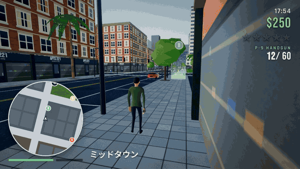

# PORT MERIDIAN

> 陽が沈む港町で、のし上がれ。 — ブラウザで遊べる、都市型3Dオープンワールド・アクションゲーム

**▶ プレイ URL（GitHub Pages）: https://onego15.github.io/gta-claude-fable/**

> ⚠️ **まだ公開されていません（2026-11-14 時点）。** デプロイ用のワークフロー（`.github/workflows/pages.yml`）は用意済みで、ビルドも成功しています。ただし、リポジトリで GitHub Pages が有効になっておらず、Actions の権限では有効化できないため、デプロイの段階で止まっています。
>
> **公開に必要な手順（リポジトリ管理者の作業）:**
> 1. GitHub のリポジトリで **Settings → Pages** を開きます。
> 2. 「Build and deployment」の **Source** を **GitHub Actions** に変更します。
> 3. **Actions** タブで「Deploy to GitHub Pages」を開き、**Run workflow**（または失敗したジョブの Re-run）を実行します。
> 4. 数分後に上の URL でゲームが起動します（ビルド成果物は相対パスなので、`/gta-claude-fable/` のサブパスでそのまま動きます）。



（上の GIF は実際のゲームを headless Chromium で動かして録画したものです。MP4 版: [docs/demo.mp4](docs/demo.mp4)）

## 概要

架空の港町「ポート・メリディアン」を舞台にした三人称視点のオープンワールドゲームです。GTA シリーズに着想を得ていますが、街・人物・車名・ロゴ・音楽・UI はすべてオリジナルです。

- 5×5 ブロックのコンパクトな街に、ダウンタウンの高層ビル、レンガのアパート街、ミッドタウンの商店街、噴水のある公園、ハーバー・マーケット、コンテナヤード、海沿いのプロムナードと桟橋があります。
- 歩行者は歩道を歩き、ベンチに座り、信号を待って横断歩道を渡ります。銃声や事故があると悲鳴を上げて逃げます。
- 車は信号のある交差点で止まり、右折・左折しながら道路網を走ります。
- 車を盗む、発砲する、警官を攻撃すると手配度（★1〜5）が上がり、パトカーと警官が道路を使って追ってきます。視界から外れて隠れ続ければ手配度は下がります。
- 3 つのストーリーミッションと、街に隠された 10 枚の「メリディアン・トークン」があります。
- 時間は 1 分で 1 時間進み、夕暮れや夜には窓、街灯、ネオン、ヘッドライトが灯ります。

## 特徴

| カテゴリ | 内容 |
|---|---|
| 街並み | 手続き生成の建物（ガラス張りのオフィス、レンガ、漆喰、倉庫などの外壁）、16 種のオリジナル店舗の看板とショーウィンドウ、ビルボード、街路樹とヤシ、信号機、街灯、消火栓、ベンチ、バス停、病院、警察署、セーフハウス |
| 人物 | Quaternius 製の人間型モデル 8 種（服の色は個体ごとにランダム）。Idle / Walk / Run のブレンド、ジャンプ、死亡、着席のアニメーションに加え、エイム時の腕・上半身 IK、ホールドアップ、被弾のよろめき |
| 車両 | 8 車種（セダン、ワゴン、SUV、スポーツカー 2 種、タクシー、パトカー 2 種）。アーケード物理、ドリフトとタイヤ痕、ボディのロールとピッチ、ダメージ、炎上と爆発、ヘッドライトとブレーキランプ、パトランプ |
| 戦闘 | ハンドガン（P-9）と SMG（VX-30）。マズルフラッシュ、反動、カメラの揺れ、着弾の火花と弾痕、ヒットマーカー、ヘッドショット、リロード、弾薬と体力と防弾ベストの管理。肩越しの TPS エイムカメラ |
| 敵 AI | 遮蔽物を探して身を隠し、顔を出して撃ち、位置を変えます。ミッションでは増援も来ます。命中率にはわざと外す弾も含まれ、撃たれている感覚が出るようにしています |
| 警察 | 手配度に応じてパトカーの台数と攻撃性が変わります。★1 では逮捕を狙い、★2 以上で発砲します。パトカーは道路網を使って追跡し、徒歩のプレイヤーには警官を降ろします。視界判定と隠れタイマーがあり、逮捕や気絶のあとは罰金を払って警察署か病院からやり直します |
| 交通・歩行者 | 道路グラフ上の車線追従（ピュアパシュート）、信号、前方車の検知、クラクション、事故時のパニック。歩行者は歩道グラフを歩き、ベンチ、横断歩道の信号待ち、逃走、うずくまり、復帰の状態を持ちます |
| 雰囲気 | 空の大気散乱、太陽と影、環境マップによる反射、霧、ブルームとカラーグレーディング、窓の夜間発光、水面、環境音、エンジン音、スキール音、サイレン、生成音楽のカーラジオ 2 局 |
| UI | 回転するミニマップと GPS ルート、★表示、ヒートクールダウンのバー、武器と弾数、速度計、ミッションの目標・タイマー・バナー、トースト通知、ポーズメニュー（全体マップ、ミッション一覧、操作方法、設定） |

### ミッション

| | タイトル | 内容 | 報酬 |
|---|---|---|---|
| D | ラスト・デリバリー | 配達用スポーツカーに乗り、80 秒以内にハーバー・マーケットへ届ける（運転） | $600＋タイムボーナス |
| S | ドック・セブン | コンテナヤードに陣取るギャングを倒す。途中で増援あり。ケースを回収すると SMG を入手（銃撃戦） | $1,200 |
| H | ヒート・ラン | ショールームの金色のスポーツカーを盗み（★3）、警察を振り切ってセーフハウスへ運ぶ（逃走） | $2,500＋車両状態ボーナス |

マップ上の D / S / H アイコンの地点で **E** キーを押すと開始します。進行状況はブラウザに保存されます。

## 操作方法

| 操作 | キー |
|---|---|
| 移動 / ダッシュ / ジャンプ | W A S D / Shift / Space |
| 視点 | マウス（クリックでマウスロック） |
| エイム / 射撃 | 右クリック / 左クリック |
| リロード / 武器切替 | R / 1・2・3・ホイール |
| 車に乗る・降りる（運転手がいれば強奪） | F |
| アクセル / ブレーキ・バック / ハンドブレーキ | W / S / Space |
| クラクション / ラジオ切替 | H / R（車内） |
| ミッション開始 | E |
| ポーズ・マップ | Esc / M |

ゲームパッドにも基本対応しています（左スティックで移動、右スティックで視点、RT で射撃、LT でエイム、Y で乗降）。

## 遊び方・ローカル起動

- **ブラウザで遊ぶ:** https://onego15.github.io/gta-claude-fable/ （公開状況は冒頭の注記を参照してください）
- **ローカルで動かす:**

```bash
npm install
npm run dev        # http://localhost:5173/ を開く
npm run build      # dist/ に静的ファイルを出力（相対パスなので任意のサブパスで動作）
npm run preview
```

推奨環境は WebGL2 対応のデスクトップ版 Chrome / Edge / Firefox です。重い場合はポーズメニューの「設定 → 画質」を「中」か「低」にしてください。

## 使用した AI とモデル

- AI サービス: Claude Code（Anthropic）。claude.ai のクラウドセッションで、プロジェクトのスレッド機能から実行しました。
- モデル: **Claude Opus 5.5（`claude-opus-5-5`）**。セッション情報 API（get_session）の `session_context.model` が `claude-opus-5-5[1m]`、`last_served_model` が `claude-opus-5-5` であることを制作中に確認しました。

## 使用技術

- **エンジン:** 自作（three.js r170 ＋ 素の JavaScript ES Modules）。ゲームエンジンは使っていません。
- **ビルド:** Vite 6（`base: './'` の相対パス出力で、GitHub Pages のサブパスに対応）
- **描画:** WebGL2、PCF ソフトシャドウ、ACES トーンマッピング、Sky シェーダー、PMREM 環境マップ、UnrealBloom、自作のカラーグレーディング用シェーダー
- **3D モデル:** Quaternius の CC0 人物モデル、Realistic Car Pack、Modular Street Pack。FBX を headless Chromium 上の three.js で GLB に変換し、gltf-transform（meshopt）で圧縮しています（`tools/convert.*`）
- **効果音:** Kenney（CC0）のエンジン音、スキール音、衝突音、街の環境音。銃声、UI 音、サイレン、ラジオの音楽は WebAudio でその場で合成しています
- **テクスチャ:** 外壁、窓、看板、アスファルト、歩道などはすべて Canvas で手続き生成しています（外部画像は使っていません）
- **フォント:** Bebas Neue、Rajdhani、Noto Sans JP（SIL OFL、@fontsource 経由）
- **テストと録画:** Playwright（headless Chromium と SwiftShader）、ffmpeg

### アセットのライセンス

| アセット | 作者 | ライセンス | 入手元 |
|---|---|---|---|
| 人物・車両・一部の道路小物 | Quaternius | CC0 1.0 | quaternius.com（GitHub ミラー `beep2bleep/FreeAssetsByKenneyNLandQuaternius` から取得） |
| エンジン音、スキール音、衝突音、環境音 | Kenney | CC0 1.0 | `KenneyNL/Starter-Kit-Racing`、`KenneyNL/Starter-Kit-City-Builder` |
| フォント | 各作者 | SIL OFL 1.1 | @fontsource |
| three.js | three.js authors | MIT | npm |

原作の固有キャラクター、地名、マップ、ロゴは使っていません。

## 制作期間

- 制作開始: 2026-11-14 03:02:31 UTC（依頼メッセージの受信時刻）
- 制作終了: 2026-11-14 06:20:05 UTC（README 最終更新時点）
- 経過時間: 約 3 時間 17 分（作業セッションの実時間です。コンテナの再起動による中断を含みます）

## テストと結果

### 自動 E2E テスト（`npm test`）

`tools/test.mjs` は、本番と同じゲームを headless Chromium（WebGL は SwiftShader）で起動します。そのうえで、仮想キー入力とテスト用 API `window.PM`（固定ステップでの進行、テレポート、状態の取得）を使ってプレイします。銃撃のテストでは、カメラを敵の胸に向けて実際に射撃処理を通しています（ダメージを直接与える近道は使っていません）。

| # | テスト | 最終結果 |
|---|---|---|
| 1 | 起動：プレイヤーが出現し、街に車と歩行者がいる | ✅ 合格 |
| 2 | 徒歩とダッシュで移動できる | ✅ 合格 |
| 3 | ジャンプで地面を離れて着地する | ✅ 合格 |
| 4 | エイムと射撃で弾が減り、リロードで補充される | ✅ 合格 |
| 5 | 車に乗り、運転して（約 59km/h）降りる | ✅ 合格 |
| 6 | NPC の車を強奪すると手配度が上がり、運転手が逃げる | ✅ 合格 |
| 7 | ★3 でパトカーが出動して追跡する | ✅ 合格 |
| 8 | 手配が解除されるとパトカーが通常の状態に戻り、去る | ✅ 合格 |
| 9 | ミッション D：開始から配達完了まで | ✅ 合格 |
| 10 | ミッション S：開始、敵の全滅（実際の照準と射撃で）、ケース回収、クリアまで | ✅ 合格 |
| 11 | ミッション H：車の強奪、★3、警察を振り切る、セーフハウスへの到着、クリアまで | ✅ 合格 |
| 12 | 死亡すると治療費を払って病院でリスポーンする | ✅ 合格 |
| 13 | 逮捕されると罰金を払って警察署でリスポーンし、手配度が 0 に戻る | ✅ 合格 |
| 14 | ポーズメニューとマップが開く | ✅ 合格 |
| 15 | 長時間の負荷テスト（交通、歩行者、戦闘を 900 フレーム動かしても破綻しない） | ✅ 合格 |

テスト中のページエラー（`pageerror` と `console.error`）は 0 件でした。最後の行の負荷テストでは、手配度★2 の状態で 900 フレーム（30 秒相当）を連続して動かし、車や人の座標が NaN になったり街の外へ飛び出したりしないことを確かめています。

### 目視確認（スクリーンショットのレビュー）

開発中は `tools/shots.mjs` で次の場面のスクリーンショットを撮り、見た目を確認しながら修正しました。

- 昼、夕方、夜の街並み
- 徒歩（横から、正面から）、エイム姿勢、走り
- 乗車、運転、カージャック
- パトカーの外観、歩行者の服装
- コンテナヤードの銃撃戦、夜の警察の追跡

`docs/demo.gif` と `docs/demo.mp4` は `tools/capture.mjs` で録画しました。ゲームを 1/30 秒の固定ステップで進め、1 フレームずつ画面を撮影しています。入力は台本で与えていますが、映像はすべて実際のゲーム画面です。

### 公開 URL での検証

公開 URL での検証は**未実施**です（Pages が未公開のため）。代わりに、本番ビルド（`npm run build` の `dist/`）を `vite preview --base /gta-claude-fable/` で Pages と同じサブパスに配信し、上の E2E テストをすべてその URL に対して実行しました。上の表はその結果です。モデル、音声、フォントがサブパスから正しく読み込まれることも確認しています。

## 改善した内容（品質ループの記録）

実装後にゲームを起動して画面を確認し、見つかった問題を次のように直しました。

**グラフィック**
- 3D モデルの圧縮時に、gltf-transform の既定設定がマテリアルを 1 枚のパレットテクスチャに統合していました。その結果、パトカーが真っ白になり、歩行者の服も個体ごとの色分けができていませんでした。パレット化を止めて全モデルを変換し直し、パトカーの白黒塗装、ガラス、ランプ、服や肌の色分けを復元しました。
- 量子化された頂点データ（int16）に変換行列をそのまま掛けていたため、車の形がトゲ状に崩れていました。float に戻してから焼き込むように直しました。
- 昼間はブルームが強すぎて画面が白っぽくかすんでいました。ブルームの強さを時間帯で変えるようにし、コントラストと彩度を上げる処理と霧の距離も調整しました。
- パトランプの点光源が車体を赤く染めすぎていたので、位置と強さを調整しました。

**アニメーション**
- 構えたときに上半身が約 70 度ねじれていました。原因は、ボーン回転のヘルパーが一時変数を共有していて、回転の差分が自分自身と掛け合わされていたことです。これを直し、エイムの方向に肩をそろえる補正も加えました。
- 手続き的に回したボーンがフレームごとに回転を蓄積し、体が反り返ったりかがみ込んだりしていました。毎フレームの初めに基本姿勢へ戻すようにしました。

**ゲーム性・バランス**
- 走行中の車をカージャックすると、ドアに引きずられて即死していました。対策は 3 つです。乗り込み中は対象の車との衝突を無視する、車が自分に向かってくるときだけはねられ判定をする、奪った車にはブレーキとハンドブレーキをかける。
- 時速 70km 程度の衝突一回で車が爆発していました。衝突ダメージを（速度 − 4）² × 0.95 に下げ、炎上し始める体力のしきい値も下げました。衝突の間隔の判定も、実時間ではなくゲーム内時間で行うようにしました。
- 気絶・逮捕の演出中のスローモーションがリスポーンのタイマーまで遅くし、復帰まで実時間で 17 秒ほどかかっていました。演出は実時間で進め、スローは最初の 2 秒だけにしました。
- 運転手を引きずり降ろしたときに歩行者 AI が正しく割り当てられていなかったため、最寄りの歩道ノードから逃げるようにしました。
- ミッションの開始カードが表示されない参照ミス（`g.ui` を `g.menus` に修正）を直しました。

**UI**
- 手配度のクールダウンバーが弾数表示に重なっていたので、位置を下げました。
- 明るい背景の上で右上の HUD が読みにくかったため、薄い影のグラデーションと文字の縁取りを付けました。

## 既知の問題と未完成部分

- GitHub Pages はまだ公開されていません（冒頭の手順を参照）。そのため、公開 URL での検証はできていません。
- 自動テストは SwiftShader（ソフトウェア描画）で動かしているため、実機の GPU での FPS は計測していません。描画負荷の目安は、SwiftShader 上でシミュレーションが 1 フレームあたり約 3〜6ms、描画が 1280×720 で約 80〜200ms です。
- 自動テストのうち「ラスト・デリバリー」は、乗車後に車を目的地の手前へ移動させてから停車と判定の処理を確かめています（道中の運転は別の運転テストと録画で確認しました）。「ヒート・ラン」の逃走部分は、パトカーを遠くへ移動させて「視界から外れた」状態を作って判定しています。実際のカーチェイスで振り切る流れは、録画と目視で確認しました。
- 歩行者や敵は Quaternius のモデルを色違いで使い回しているため、顔の種類は 8 種類しかありません。
- 車同士の衝突は箱（OBB）による簡易な判定なので、高速で斜めにぶつかると不自然に跳ねることがあります。
- 音楽は WebAudio で生成したシンプルなループで、ボーカル入りの楽曲はありません。
- スマートフォンのタッチ操作には対応していません（キーボード、マウス、ゲームパッドのみ）。
- 地下や建物の内部はなく、建物には入れません。

## リポジトリ構成

```
src/
  core/      描画（Graphics）・入力・カメラ・音響・ラジオ・アセット読込
  world/     街の配置（layout）・建物と小物の生成（city/props/geo/textures）・空と時間帯・当たり判定
  actors/    人型キャラクター（アニメーションと IK）・車両の物理・プレイヤー
  ai/        交通・歩行者・敵の戦闘 AI・警察と手配度・道路グラフ
  combat/    弾道判定・エフェクト
  systems/   ミッション・トークン
  ui/        HUD・メニュー
public/models, public/audio   変換済みの CC0 アセット
tools/       アセット変換・スクリーンショット・E2E テスト・録画のスクリプト
```

## 依頼プロンプト全文

以下は、この作品の制作に使った依頼プロンプトを省略・改変せずに載せたものです（同じ内容を [docs/PROMPT.md](docs/PROMPT.md) にも置いています）。

````text
GTAシリーズに着想を得た、都市型3Dオープンワールドゲームを制作してください。
ブラウザでプレイ可能な、商業インディーゲームのような完成度を目指してください。
最も重視するのは、都会的で生活感のある3D街並み、自然な人間のキャラクターとアニメーション、車両の挙動、銃撃戦と警察の追跡、自由に街を探索できる楽しさです。
1. ゲーム内容

* 三人称視点で都市を自由に歩き回れる
* 道路、歩道、ビル、商店、公園などがある都市空間
* 歩行者や自動車が街の中を移動している
* 車に乗り降りして運転できる
* 銃撃戦や警察からの逃走ができる
* 街を探索しながら楽しめる小さなミッションやアクティビティ
* 歩行・運転・戦闘のそれぞれで快適なカメラ操作

2. グラフィック

* 単なる直方体を並べた都市ではなく、建築様式、道路設備、看板、店舗、窓、街路樹などが作り込まれた都市
* 歩行者は人間らしい体型と服装を備え、自然な歩行アニメーションを持つ
* 主人公にも人間らしいモデルとアニメーションを用意
* 車は自動車と分かる完成度のあるモデルを使用
* 光、影、反射、時間帯、環境音などで街の雰囲気を作る
* 世界観と調和したUI/UX

3. 銃撃・戦闘システム

* プレイヤーが銃を装備し、照準を合わせて射撃できる
* 射撃時のマズルフラッシュ、反動、発射音、着弾エフェクトを実装する
* 弾数、リロード、HPなどの基本的な戦闘システムを用意する
* 敵NPCとの銃撃戦を楽しめる
* 敵NPCは移動、遮蔽物の利用、攻撃などの行動を取る
* 戦闘時には三人称シューティングに適したカメラワークに切り替わる
* 過度にリアルな暴力描写よりも、ゲームとしての爽快感と遊びやすさを優先する

4. 指名手配・警察システム
GTAシリーズのように、プレイヤーの行動によって指名手配レベルが変化するシステムを実装してください。

* 発砲、車両の強奪、警察への攻撃などで指名手配レベルが上昇する
* 指名手配レベルを星（★）で表示する
* レベルに応じて警察官やパトカーの数、追跡の積極性が変化する
* 警察はプレイヤーを発見すると追跡し、状況に応じて攻撃する
* 車での逃走や徒歩での逃走が可能
* 警察の視界から逃れて一定時間隠れると、指名手配レベルが低下する
* 逮捕・死亡時には適切なペナルティとリスポーン処理を行う
* 警察の追跡が終わった後は、通常の街の状態に戻る

5. 街のNPC・交通AI

* 歩行者が街を自然に歩き回る
* NPCは発砲や危険な運転に反応し、逃げるなどの行動を取る
* 自動車が道路に沿って走行し、交差点などで自然に振る舞う
* パトカーは道路を利用してプレイヤーを追跡する
* 戦闘や警察の追跡が起きても、街全体のシミュレーションが破綻しないようにする

6. ミッション
自由探索に加えて、銃撃・運転・警察からの逃走を楽しめる短いミッションを用意してください。
例：

* 指定された目的地まで車で移動する
* 敵NPCと銃撃戦を行う
* 警察の追跡から逃れて安全な場所に到達する

ミッションはコンパクトでも構いませんが、開始からクリアまで正常に進行することを重視してください。
7. 制作方針
3Dキャラクターや車両など、コードだけで高品質に制作するのが難しい素材については、外部アセットの活用を積極的に検討してください。
利用可能な無料・適切なライセンスの3Dモデル、テクスチャ、アニメーションなどを探し、必要に応じてゲームに組み込んでください。
ただし、ライセンスを遵守し、原作の固有キャラクターやマップをコピーしないでください。
大規模な都市や大量のミッションより、コンパクトでも作り込まれた、生活感のある街を優先してください。
エンジン、言語、フレームワーク、アートスタイルは自由です。
8. 品質改善・自律制作（最重要）
ゲームが動作するようになった段階では、まだ完成ではありません。
基本機能の実装後、グラフィック、アニメーション、演出、UI/UX、ゲームバランスを改善する工程を必ず設けてください。

* 機能が実装されたことだけを理由に完成と判断しない
* 実際にゲームを起動してスクリーンショットを確認し、見栄えの悪い部分を改善する
* プリミティブな図形や仮素材を使った場合は、最終的に作品の世界観に合う素材へ置き換える。ただし意図的なアートスタイルとして成立している場合は除く
* 背景、キャラクター、建物、UI、アニメーション、音響まで一貫したアートディレクションを行う
* 人物の見た目、歩行、車の乗降、運転、銃撃、交通AI、警察の追跡をテストする
* ミッション開始から終了まで正常に進行するか確認する
* 初回の実装で満足せず、問題の発見・修正・再確認を繰り返す
* 制作時間の短縮よりも最終的なゲーム品質を優先する
* コンテンツ量を増やすより、少ない要素を高品質に仕上げる

目標は動作する技術デモではなく、人が遊んで楽しいと感じる、視覚的にも完成されたゲームです。
私への途中確認は不要です。利用可能な作業時間・ツール・実行予算の範囲で自律的に制作してください。
9. GitHub Pagesでの公開
完成したゲームをGitHub Pagesで公開し、ブラウザからすぐに遊べる状態にしてください。

* GitHub Pagesで動作する静的Webアプリとして構築する
* 必要に応じてGitHub Actionsによる自動ビルド・デプロイを設定する
* リポジトリ名を含むサブパスで正常に動作するようにする
* 3Dモデル、テクスチャ、アニメーション、音声などのアセットを正しく読み込む
* READMEの冒頭にゲームをプレイするためのURLを掲載する
* 公開URLで起動、描画、操作、ミッション進行を検証する
* GitHubへの権限や設定が不足している場合は、残りの手順をREADMEに記載する

公開できていない状態を公開済みと記載しないでください。
10. GitHub README・制作記録
README.mdには以下を含めてください。

1. ゲームタイトルと概要
2. 実際のプレイ映像を録画した10〜15秒程度のGIFアニメーション
   * `docs/demo.gif` に配置し、README冒頭付近に埋め込む
   * 街並み、人物、運転、銃撃、警察追跡などが伝わる場面を収録する
   * 可能ならMP4動画も保存する
3. ゲームの特徴・操作方法
4. GitHub PagesのプレイURLとローカル起動方法
5. 使用したAIサービス名と正確なモデル名
6. 使用技術・ゲームエンジン
7. 制作開始・終了日時と経過時間（確認できる範囲）
8. 実施したテストと結果
9. グラフィック・UI・ゲーム性について改善した内容
10. 制作に使用した、この依頼プロンプトの全文（省略・要約・改変禁止）
11. 既知の問題と未完成部分

GIFは実際に動作するゲームから録画し、架空のプレイ映像で代用しないでください。
モデル名や制作時間など、確認できない情報は推測せず「未確認」と記載してください。
11. 比較実験に関する条件
この作品は、過去に別モデルで制作した作品との比較実験です。
以前制作したゲームのコード、モデル、素材などを流用せず、新規に制作してください。公開されている一般的なライブラリや、利用条件を遵守した第三者のアセットは利用して構いません。
過去作品の再現ではなく、このプロンプトに対して独自に最良の解決策を選んでください。
私への質問や途中確認は不要です。企画、実装、アセット制作、テスト、品質改善、GitHub Pagesへの公開準備、README作成まで自律的に進めてください。
````
